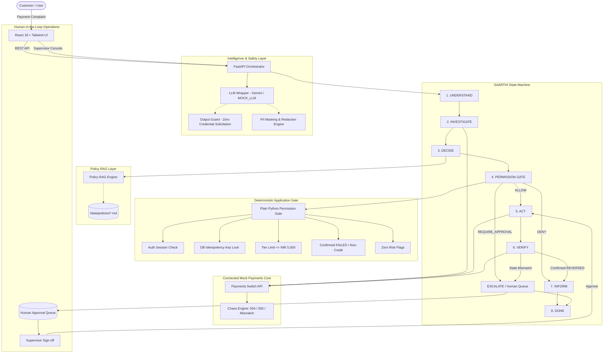

# SAARTHI: Autonomous AI Teammate for Verified Payment Dispute Resolution

> *"Don't automate the conversation. Automate the resolution."*

SAARTHI is a production-grade working prototype that turns raw customer payment complaints (e.g., *"₹2,000 debited, but the merchant says payment failed"*) into verified, authoritatively resolved cases. Instead of reciting FAQ scripts or guessing payment states, Saarthi runs a closed-loop autonomous cycle:

$$\text{Understand} \longrightarrow \text{Investigate} \longrightarrow \text{Decide} \longrightarrow \mathbf{\text{Gate (Python)}} \longrightarrow \text{Act} \longrightarrow \mathbf{\text{Verify (Re-check)}} \longrightarrow \text{Inform}$$

---

## 1. System Architecture



---

## 2. Pitch Deck Claims Mapped Directly to Code

| Pitch Deck Principle | Design Guarantee | Exact Implementation in Code |
| :--- | :--- | :--- |
| **1. The LLM Proposes; Application Decides** | The LLM never touches payment rails or triggers mutations directly. It only selects approved tools and proposes parameters. A deterministic Python gate validates all preconditions. | [`backend/gate/permission_gate.py`](file:///backend/gate/permission_gate.py)<br>Class `DeterministicPermissionGate.evaluate()` validates customer auth, status eligibility, financial limit, risk flags, and DB idempotency before any tool call executes. |
| **2. Never Infer Transaction Status** | If an API lookup fails, times out, or returns `PENDING_CONFIRMATION`, the system treats it strictly as `UNCONFIRMED`. Never speculate. | [`backend/agent/state_machine.py`](file:///backend/agent/state_machine.py#L140)<br>Explicitly flags `UNCONFIRMED_PENDING`, creates tracked case, and states: *"I can't call it failed or successful yet."* |
| **3. Zero-Assumption Verification** | A tool call is never assumed to have worked. An action is only marked `Resolved` when an authoritative post-action state re-check confirms settlement. | [`backend/agent/state_machine.py`](file:///backend/agent/state_machine.py#L330)<br>Step `VERIFY` calls `check_transaction_status()` after reversal; if state remains un-reversed, it marks `VERIFICATION_MISMATCH` and escalates. |
| **4. Strict Credential Protection** | Never solicit OTP, PIN, CVV, or 16-digit card numbers. PII masked in all logs and LLM contexts. | [`backend/agent/guards.py`](file:///backend/agent/guards.py) & [`backend/db/audit.py`](file:///backend/db/audit.py)<br>`OutputGuard.sanitize_and_validate()` intercepts and replaces any prompt asking for OTP/PIN with a security warning. |
| **5. Database-Enforced Idempotency** | Reversal operations cannot execute twice on the same transaction. Repeated complaints return the previous result safely. | [`backend/db/models.py`](file:///backend/db/models.py)<br>`IdempotencyRecord` table with `UniqueConstraint("action_type", "txn_id")` and key locking. |
| **6. Immutable Audit Trail** | Every step, tool invocation, input, output, and policy citation is logged with timestamps. | [`backend/db/audit.py`](file:///backend/db/audit.py)<br>`log_audit_event()` persists actor, action, masked payloads, decision reasons, and cited policy chunks. |
| **7. Real Metrics Only** | Zero fake statistics in UI. Every counter is dynamically queried from active database runs. | [`backend/api/routes.py`](file:///backend/api/routes.py#L270)<br>`/api/metrics` dynamically computes counts from local SQLite database rows. |

---

## 3. Failure Handling Matrix

| Failure Condition | Prototype Behavior | Verification in Code / Test |
| :--- | :--- | :--- |
| **Lookup Fails (404 / 500)** | Halts automation immediately; never infers state; escalates to human agent with brief. | Tested in `test_failure_matrix_1_lookup_fails_escalate_never_infer` |
| **API Gateway Timeout (504)** | Retries up to 2 times, re-checking authoritative state before retrying; escalates on exhaustion. | Tested in `test_failure_matrix_2_api_timeout_retries_and_escalates` |
| **Status Ambiguous / Pending** | Classifies as `AWAITING_STATUS_CHANGE`; promises automated status-change notification at T+24h. | Tested in `test_failure_matrix_3_ambiguous_pending_status_never_infer` |
| **Duplicate Complaint Submitted** | Idempotency guard blocks second reversal execution; returns previous settlement reference. | Tested in `test_failure_matrix_4_duplicate_attempt_idempotency_blocks` |
| **State Re-check Mismatch** | Reversal API succeeds but post-action check remains un-reversed; marked unresolved and escalated. | Tested in `test_failure_matrix_5_verification_fails_unresolved_escalated` |
| **High Value (> INR 5,000)** | Pauses automation, flags `REQUIRE_APPROVAL`, routes to Human Console for supervisor approval. | Tested in `test_failure_matrix_6_approval_required_pauses_for_human` |

---

## 4. Quick Start & Execution

### Option A: Local Dev (One Command)
Requires Python 3.11+ and Node.js 18+:

```bash
# 1. Setup backend environment and install dependencies
python -m venv .venv
.\.venv\Scripts\pip install -r backend/requirements.txt

# 2. Setup frontend
cd frontend
npm install
cd ..

# 3. Launch both backend & frontend
powershell -ExecutionPolicy Bypass -File ./run_saarthi.ps1
# or using Makefile
make dev
```

- Customer Chat & Operations Console: **`http://localhost:5173`**
- FastAPI Backend & Swagger Docs: **`http://localhost:8000/docs`**
- Payments Core Switch API: **`http://localhost:8000/payments-core/transactions`**

### Option B: Docker Compose
```bash
docker compose up --build
```

---

## 5. Running the Test Suite

Saarthi includes unit and integration tests covering the Permission Gate, Idempotency, Output Guards, the 6 Failure Matrix rows, and Scenarios A through I in deterministic `MOCK_LLM` mode (no API key required):

```bash
.\.venv\Scripts\pytest -v
```

Output:
```text
backend/tests/test_failure_matrix.py::test_failure_matrix_1_lookup_fails_escalate_never_infer PASSED
backend/tests/test_failure_matrix.py::test_failure_matrix_2_api_timeout_retries_and_escalates PASSED
backend/tests/test_failure_matrix.py::test_failure_matrix_3_ambiguous_pending_status_never_infer PASSED
backend/tests/test_failure_matrix.py::test_failure_matrix_4_duplicate_attempt_idempotency_blocks PASSED
backend/tests/test_failure_matrix.py::test_failure_matrix_5_verification_fails_unresolved_escalated PASSED
backend/tests/test_failure_matrix.py::test_failure_matrix_6_approval_required_pauses_for_human PASSED
backend/tests/test_gate.py::test_gate_allows_valid_reversal PASSED
backend/tests/test_gate.py::test_gate_requires_approval_above_limit PASSED
backend/tests/test_gate.py::test_gate_allows_when_supervisor_approved PASSED
backend/tests/test_gate.py::test_gate_denies_on_risk_flag PASSED
backend/tests/test_gate.py::test_gate_denies_pending_confirmation PASSED
backend/tests/test_guards.py::test_output_guard_blocks_otp_requests PASSED
backend/tests/test_guards.py::test_output_guard_blocks_pin_and_cvv PASSED
backend/tests/test_guards.py::test_output_guard_allows_safe_messages PASSED
backend/tests/test_guards.py::test_pii_masking_phone_and_cards PASSED
backend/tests/test_guards.py::test_pii_masking_nested_data PASSED
backend/tests/test_idempotency.py::test_idempotency_blocks_duplicate_reversal PASSED
backend/tests/test_idempotency.py::test_idempotency_blocks_same_action_different_key_on_same_txn PASSED
backend/tests/test_scenarios.py::test_scenario_a_failed_payment_verified_resolution PASSED
backend/tests/test_scenarios.py::test_scenario_b_pending_confirmation_unconfirmed PASSED
backend/tests/test_scenarios.py::test_scenario_c_duplicate_debit PASSED
backend/tests/test_scenarios.py::test_scenario_d_risk_flagged_transaction PASSED
backend/tests/test_scenarios.py::test_scenario_e_above_auto_limit_approval_flow PASSED
backend/tests/test_scenarios.py::test_scenario_f_verification_mismatch PASSED
backend/tests/test_scenarios.py::test_scenario_g_repeat_complaint_idempotency PASSED
backend/tests/test_scenarios.py::test_scenario_h_hinglish_language_support PASSED
backend/tests/test_scenarios.py::test_scenario_i_faq_no_case_created PASSED
============================= 27 passed in 3.01s ==============================
```

---

## 6. Demo Walkthrough Script

| Scenario | Customer Complaint Input | Expected Behavior & UI Screen |
| :--- | :--- | :--- |
| **A. Verified Auto-Reversal** | *"₹2,000 debited for my Zomato order TXN-1001, but the app says payment failed. Please refund my money."* | Understand -> Investigate -> Gate ALLOW -> Reversal executed -> State recheck confirmed -> **Resolved (Verified)** with RRN. |
| **B. Pending Confirmation (Never Infer)** | *"I paid ₹2,000 on Swiggy TXN-1002, money left my bank account but Swiggy says waiting for bank confirmation."* | Investigates core status `PENDING_CONFIRMATION` -> Refuses to call failed or successful -> Sets **Awaiting Status Change** -> Case Brief generated. |
| **C. Duplicate Debit** | *"I was charged ₹650 twice for the same Amazon order TXN-1003B! Reverse the extra debit."* | Detects duplicate debit -> Preserves primary transaction -> Reverses only secondary debit -> Verified resolved. |
| **D. Flagged Security Risk** | *"Why was my payment TXN-1004 of ₹3,500 on CryptoPay declined? Refund immediately."* | Gate intercepts `FRAUD_SUSPECTED` / `VELOCITY_BREACH` -> Immediately halts automation -> Routes to Risk Ops. |
| **E. Supervisory Authorization** | *"Payment of ₹12,000 for my Croma purchase TXN-1005 failed. Money got cut from my account."* | Amount > ₹5,000 auto limit -> Gate flags `REQUIRE_APPROVAL` -> Supervisor approves in **Human Console** -> Saarthi executes and verifies. |
| **F. Verification State Mismatch** | *"My Uber ride TXN-1006 for ₹1,800 failed at payment gateway. Please reverse."* | Reversal API returns 200, but state recheck remains FAILED -> Recheck fails -> Marked **Unresolved & Escalated**. |
| **G. Repeated Complaint** | *(Submit identical complaint for TXN-1007 twice)* | Idempotency key in DB blocks second write -> Returns existing settlement reference. |
| **H. Multi-lingual (Hinglish)** | *"Mera 1500 cut gaya Blinkit TXN-1008 par merchant bola payment fail ho gaya. Paise wapas chahiye."* | Detects Hinglish -> Parses intent -> Executes verified resolution -> Replies in clear Hinglish. |
| **I. Informational FAQ** | *"What does a debit mean? Why do payments fail sometimes?"* | Answers customer question informatively -> Zero financial case records created. |

---

## 7. Current Status & Next Steps

### ✅ What works (verified)
- **Backend:** FastAPI app runs; `pytest -v` → **27/27 pass** in `MOCK_LLM=true` mode (Permission Gate, idempotency, OTP/PIN guard, all 6 failure-matrix rows, scenarios A–I).
- **Mock Payments Core:** 30 seeded transactions, authoritative status check, reversal with Idempotency-Key, chaos switches (lookup fail / timeout / ambiguous / verification mismatch).
- **Agent loop:** 9 approved tools, deterministic Permission Gate (ALLOW / REQUIRE_APPROVAL / DENY), explicit state machine, Policy RAG with citations, immutable audit log, PII masking + output guard.
- **Frontend:** Customer Chat (live step indicator + status chips), Agent Trace, Human Console, Admin/Demo panel (chaos toggles + reset), honest Metrics. Admin "Run Scenario" now auto-runs in Chat; all scenarios A–I are demoable.
- **Git:** Committed and pushed to `main`. Latest commit: `f7515bd`.

### ▶️ How to run (Linux/macOS)
```bash
python -m venv .venv && source .venv/bin/activate
pip install -r backend/requirements.txt
cd frontend && npm install && cd ..

# Terminal 1 — backend (http://localhost:8000, docs at /docs)
MOCK_LLM=true uvicorn backend.main:app --reload --port 8000

# Terminal 2 — frontend (http://localhost:5173)
cd frontend && npm run dev
```
Seed data auto-loads on startup. On Windows use `powershell -ExecutionPolicy Bypass -File ./run_saarthi.ps1` or `make dev`.

### 🔜 Next Steps (prioritized)
1. **P1 — Supervisor customer replies surfaced in Chat UI** (currently written to case steps via `POST /api/cases/{id}/reply` but not shown in the chat thread).
2. **P1 — Demo walkthrough:** update `backend/scripts/walkthrough.py` selectors to the current UI labels and re-capture screenshots.
3. **P2 — Production hardening:** swap SQLite → PostgreSQL via `DATABASE_URL`, add pytest coverage for the `/api/chat` HTTP layer, add CI (GitHub Actions) to run the suite on push.

---

## 8. Honest Limitations & Scope

> [!IMPORTANT]
> **What Works vs. What is Simulated**

1. **Simulated Payments Core:** The banking switch (`/payments-core`) and its 30 seeded accounts, merchants, and failure modes are an authentic simulation modeled after NPCI UPI / IMPS switch specifications. It is not connected to a live banking license.
2. **Deterministic Fallback (`MOCK_LLM=true`, default):** To ensure 100% test reliability and offline execution without requiring third-party API keys or incurring token costs, the prototype includes a fully functional rule-based mock LLM. To use a **real LLM**, set `MOCK_LLM=false` and provide `EMERGENT_LLM_KEY` (universal key, works with any provider/model — default `openai/gpt-5.4`) or `GEMINI_API_KEY` (legacy direct path). On any API failure it gracefully falls back to the deterministic engine.
3. **Prototype Run Data Only:** The Metrics Dashboard queries local SQLite database counts of disputes run in the active session. It does NOT make fabricated claims about real-world resolution statistics.
4. **Local Database:** Defaults to SQLite with full SQLAlchemy ORM mappings ready for PostgreSQL via `DATABASE_URL`.

